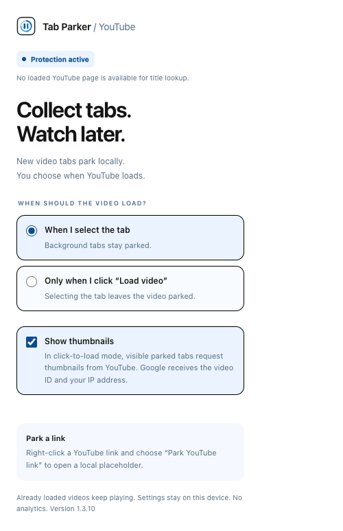

# YouTube Tab Parker

Keep newly opened YouTube videos parked on a lightweight local page until you choose to load them.

[Download the latest release](https://github.com/fbn90/youtube-tab-parker/releases/latest)

## Features

- Open a YouTube link in a background tab or use the **Park YouTube link** context-menu action.
- Choose load on selection or click-to-load mode. The placeholder shows the title and channel when available locally.
- Visible thumbnails are optional. Enable manual mode to choose whether to load thumbnails.

## Install

1. Download the extension ZIP from Releases and extract it to a permanent folder.
2. Open `chrome://extensions` and enable **Developer mode**.
3. Choose **Load unpacked** and select the extracted folder containing `manifest.json`. Pin the extension if you want its popup in the toolbar.

For an update, keep the same local extension directory so Chrome retains the extension ID and its local settings. Before reloading Parker with parked tabs open, use Tab Atelier’s **Update Tab Parker safely** workflow to hold and restore them.

## Screenshot

## Privacy

The player stays parked until you load the tab. An enabled thumbnail is requested from YouTube. Google receives the video ID and your IP address. The extension has no analytics service.

## Development

Run the JavaScript checks with `npm test`.

## License

[MIT](LICENSE).
